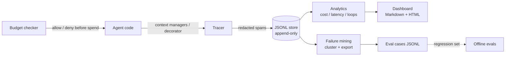

# Agent Trace Observability — production traces & cost analytics for AI agents

An agent in production is a black box: a request goes in, an answer (and a
bill) comes out, and when either is wrong there is nothing to inspect. This
repo captures every run as a **trace** of timed, costed **spans** — each LLM
call, tool call and guard check — then does the analysis most dashboards
skip: **cost per successful request** (not per call), **pre-flight budget
caps**, loop detection, and **failure mining** that exports production
failures as eval cases.

Stdlib only. No network, no API keys, fully deterministic.

> Synthetic data only. Independent project, not affiliated with or endorsed
> by any vendor or employer.

## Recruiter summary

- **Problem:** teams can demo an agent but cannot answer "what does a
  successful request actually cost?", "which tool is slow?", or "what
  broke?" once it is live.
- **Approach:** a Langfuse-style tracing layer (span trees, append-only
  JSONL store, redact-before-store), pure-function analytics, a budget
  checker consulted *before* spend, and mining that clusters failures by
  error signature and exports them as regression eval cases.
- **Proof:** 96 deterministic tests; a simulated 40-request production day
  for a fictional retailer where cost per successful request ($0.003358)
  runs ~21% above cost per request ($0.002770) — the gap is failed and
  looping runs that per-call dashboards hide.

## How it works

1. **Instrument** — `Tracer` wraps a request in a trace (context manager)
   and each unit of work in a span; a `@tracer.tool(...)` decorator does
   it automatically for tool functions. LLM spans carry token counts and
   cost from the provider response.
2. **Redact** — span input/output summaries pass through PII redaction
   before storage: phone numbers, SSNs and card-like runs removed; dates
   preserved.
3. **Store** — append-only JSONL (one crash can lose the last record,
   never corrupt history), with filtered queries by session, user, agent,
   version, status and time range.
4. **Check budgets pre-flight** — `BudgetChecker` holds per-user and
   global daily ledgers and returns allow/deny with a reason *before* a
   run starts. Denied runs are recorded as `budget_blocked` traces.
5. **Analyse** — cost per request vs per success; breakdowns by model,
   tool, user and version; latency p50/p95/p99 per span kind and per
   tool; success rate by version; loop detection (span-count blowups and
   repeated identical tool calls).
6. **Mine failures** — select failed / blocked / slow / expensive
   traces, cluster by error signature (digit-normalised, so the same
   outage forms one cluster), export as eval cases with the expectation
   "this should succeed".

## Architecture



See [knowledge/03-architecture.md](knowledge/03-architecture.md) for the
component table and design decisions.

## Demo: one simulated production day

A fictional support agent for "Cinder Peak Outfitters" (an invented
outdoor-gear retailer) handles 40 scripted requests: order lookups,
refunds, deep-dive research requests from one power user, tool outages, a
tool loop, and one request stopped by the daily budget cap.

```bash
python3 demos/demo_run.py --out demos/output
```

Real output from that run:

```text
traces: 40 (success 33, failure 6, budget_blocked 1)
total cost: $0.1108
cost per request: $0.002770
cost per successful request: $0.003358
loop flags: 1
failure clusters: 4
eval cases exported: 19
```

Per-version view from the generated dashboard (`demos/output/dashboard.md`):

| Version | Requests | Success rate | Cost | Cost / success |
|---|---|---|---|---|
| 1.0 | 18 | 77.8% | $0.008944 | $0.000639 |
| 2.0 | 22 | 86.4% | $0.101856 | $0.005361 |

v2's higher cost per success is a traffic-mix effect (11 deep-dive
research requests at $0.0088 each), not worse reliability — its success
rate is higher. [knowledge/02](knowledge/02-cost-per-success.md) explains
why per-success comparisons must be read per segment.

Failure clusters found in the same run: one `get_order` timeout cluster
(4 traces — the 3000 ms and 5000 ms variants merged by digit
normalisation), a payment-rail rejection, a warehouse-feed outage, and
the budget block. The looping trace *succeeded* — loop detection, not
success rate, is what surfaces it.

## Code excerpt

```python
from tracing import Tracer, JsonlStore

tracer = Tracer(store=JsonlStore("traces.jsonl"))
with tracer.trace(session_id="s-1", user_id="u-9",
                  agent_name="support-agent", agent_version="2.0") as run:
    with run.span("tool", "get_order") as span:
        span.input_summary = "order_id=CP-1042"
        span.output_summary = "status: shipped"
    run.record_llm("respond", model="your-model", prompt_tokens=500,
                   completion_tokens=120, cost_usd=0.000392,
                   duration_ms=340.0)
```

## How to run

```bash
python3 -m pytest tests/          # 96 tests, offline, deterministic
python3 demos/demo_run.py         # writes demos/output/{traces.jsonl,
                                  #   dashboard.md, dashboard.html,
                                  #   eval_cases.jsonl}
python3 scripts/count_tests.py    # prints the collected test total
python3 scripts/check_brands.py   # brand/collision check
```

## Guardrails and security controls

- **Redact before store:** no code path persists an unredacted span
  summary; phone patterns run before generic digit runs so numbers are
  removed whole. Dates are intentionally preserved (see
  `tracing/redact.py`).
- **Pre-flight budget caps** per user and globally, with denial reasons;
  blocked demand stays visible as `budget_blocked` traces.
- **Orphan spans are reported**, not silently dropped or mis-attributed:
  a missing parent means instrumentation lost data.
- **Threat note:** traces are behavioural data. Even redacted, span
  summaries can leak business detail; treat the store as sensitive,
  keep retention short, and never log raw payloads into summaries.

## Limitations and known failures

- The workload is **simulated** and the model pricing is illustrative;
  no live vendor integration exists. There are no Langfuse/OpenTelemetry
  exporters yet — the store interface is the seam where one plugs in
  (see the implementation guide).
- Latency percentiles are nearest-rank over stored spans — fine at this
  scale, not a streaming sketch (t-digest / HDR histogram territory).
- The budget ledger is single-process and in-memory; a real deployment
  needs a shared store and atomic check-and-record.
- Span summaries are truncated at 240 characters by the decorator API;
  deliberate, but it can clip context a debugger wanted.

## Built / Written-not-run / Planned

| Item | Status |
|---|---|
| Trace/span model, span-tree rebuild, validation | Built, tested |
| Tracer context managers + tool decorator + `record_llm` | Built, tested |
| PII redaction (phone/SSN/card, date-preserving) | Built, tested |
| JSONL store (append-only) + in-memory store + queries | Built, tested |
| Cost per request vs per success; breakdowns; latency percentiles | Built, tested |
| Loop detection (span count + repeated identical tool calls) | Built, tested |
| Budget checker (per-user/global daily caps, pre-flight) | Built, tested |
| Failure mining: selection, clustering, eval-case export | Built, tested |
| Simulated workload + Markdown/HTML dashboard | Built, tested |
| Langfuse / OpenTelemetry exporter | Planned (store-interface adapter) |
| Shared (multi-process) budget ledger | Planned |
| Streaming percentile sketches | Planned |

## Related repos

- **Jagadish-llm-evals-observability** — scores agents *offline*
  (trajectory/behaviour metrics, judge-bias probes). This repo observes
  agents *in production* and manufactures cases for that offline scoring.
- **Jagadish-agent-feedback-loop** — mines *user feedback* (ratings,
  corrections) into eval cases. This repo mines *execution traces*; no
  human has to complain first.
- **Jagadish-agent-eval-studio** — an end-to-end eval project (refund
  agent, 7 metrics, v1→v2 improvement loop) whose agent is the kind of
  system this tracer would observe live.

## Docs

- [knowledge/](knowledge/README.md) — why traces, cost per success,
  architecture, from traces to evals.
- [docs/implementation-guide.md](docs/implementation-guide.md) —
  adopting the pattern in a real system.
- [docs/interview-points.md](docs/interview-points.md) — talking points
  and design defences.
