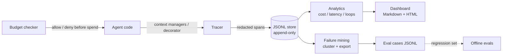

# 03 — Architecture

## Components

| Module | Responsibility |
|---|---|
| `tracing/model.py` | `Trace` / `Span` dataclasses, span-tree reconstruction, validation (orphans surfaced, never dropped) |
| `tracing/instrument.py` | `Tracer` with context-manager and decorator APIs, `record_llm` for adapter-supplied token/cost data, injectable `FakeClock` / `SequentialIds` for deterministic tests |
| `tracing/redact.py` | PII redaction applied to span summaries before storage (specific patterns before generic digit runs) |
| `tracing/store.py` | Append-only JSONL store + in-memory store; filtered queries by session/user/agent/version/status/time |
| `tracing/analytics.py` | Cost per request vs per success, breakdowns (model/tool/user/version), latency percentiles, loop detection, success rate by version |
| `tracing/budgets.py` | Per-user and global daily caps, checked *before* a call with an allow/deny decision and reason |
| `tracing/mining.py` | Failure/outlier selection, error-signature clustering, eval-case export |
| `demos/` | Simulated 40-request workload for a fictional retailer + Markdown/HTML dashboard generator |

## Key decisions

- **Stdlib only.** The point is the data model and the analysis, not a
  framework. A Langfuse or OpenTelemetry exporter would plug in at the
  store boundary: spans already carry the fields those systems expect
  (ids, parent links, timestamps, durations, token counts, cost).
- **Append-only JSONL.** One record per line, never rewritten. A crash can
  lose the last record but cannot corrupt history; loading is a single
  pass.
- **Budgets are pre-flight, not post-hoc.** The checker is consulted with
  an *estimate* before the agent runs and owns a deterministic daily
  ledger. Post-hoc budget reports are accounting; pre-flight checks are
  control.
- **Everything analytic is a pure function** over loaded traces/spans, so
  every dashboard number can be reproduced in a unit test from a
  hand-computed fixture.
